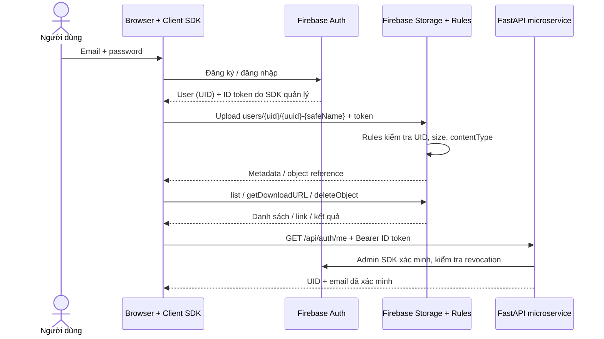

# Authentication & File Operations

Tài liệu dành cho phần số 2 của seminar Firebase Storage. Đầu ra: người dùng tự thực hiện đăng nhập → upload → liệt kê → lấy link/tải → xóa, và bạn học có thể lấy module để áp dụng vào đồ án.

## 1. Bài toán thực tế và phạm vi

Ứng dụng bán hàng cần ảnh sản phẩm, LMS cần PDF bài nộp, tuyển dụng cần CV và ứng dụng quản lý sự kiện cần ảnh minh chứng. Lưu file trên ổ đĩa của một container sẽ khó dùng khi scale nhiều instance; lưu byte file trong bảng nghiệp vụ cũng làm backup và truyền dữ liệu nặng hơn. Object storage giữ byte, còn database của microservice giữ định danh và quan hệ nghiệp vụ.

Cloud Storage for Firebase cung cấp SDK thao tác file và tích hợp Firebase Authentication/Storage Rules. Trong demo, browser truyền file trực tiếp tới Storage; FastAPI minh họa việc xác minh danh tính. Việc cấp quyền theo lớp học, sản phẩm hay nhóm dự án cần policy nghiệp vụ bổ sung; prefix UID hiện tại chỉ biểu diễn quyền sở hữu cá nhân.

## 2. Kiến trúc và workflow



Backend không nhận password của người dùng, không proxy byte file trong luồng này, và không tin UID do browser tự khai. Browser dùng **Client SDK**, nên request đến Storage được kiểm tra bằng Rules. Khi backend thao tác Storage bằng Admin SDK, quyền do IAM/backend kiểm soát, không phải Storage Rules. [Verify ID tokens](https://firebase.google.com/docs/auth/admin/verify-id-tokens), [Admin Storage](https://firebase.google.com/docs/storage/admin/start)

## 3. Đăng ký, đăng nhập, phiên

`frontend/firebase-client.js` đọc config công khai từ `GET /api/demo-config`, khởi tạo SDK rồi nối emulator khi `DEMO_MODE=emulator`. Cả Auth, Storage và CLI phải dùng cùng project ID. Không đặt service-account JSON vào frontend. [Emulator Auth](https://firebase.google.com/docs/emulator-suite/connect_auth)

`frontend/auth.js` export:

| Hàm | Kết quả / ý nghĩa |
|---|---|
| `register(email, password)` | Tạo tài khoản và đăng nhập luôn |
| `login(email, password)` | Đăng nhập tài khoản đã có |
| `logout()` | Kết thúc phiên ở client |
| `watchAuth(callback)` | Nhận user hoặc null khi trạng thái thay đổi; trả hàm unsubscribe |
| `getCurrentUser()` | User hiện tại hoặc null |
| `verifyWithBackend()` | Lấy ID token và gửi tới `/api/auth/me` |

UI đợi `ready`, đăng ký observer rồi mới cho thao tác. Phiên dùng `browserSessionPersistence`: giữ khi reload trong phiên tab, không chủ động lưu password hay token vào code/localStorage riêng. SDK quản lý việc làm mới token. Demo không bao gồm quên mật khẩu, xác minh email hay MFA; production cần thiết kế vòng đời tài khoản phù hợp. [Password auth](https://firebase.google.com/docs/auth/web/password-auth), [Auth persistence](https://firebase.google.com/docs/auth/web/auth-state-persistence)

```javascript
import { ready } from './firebase-client.js';
import { login, watchAuth } from './auth.js';
await ready;
const unsubscribe = watchAuth(user => console.log(user ? user.uid : 'Đã đăng xuất'));
await login('demo@example.com', 'demo-password');
// Khi hủy màn hình: unsubscribe(); Không log ID token/password.
```

## 4. File reference và cơ chế lưu trữ

`ref(storage, path)` tạo tham chiếu đến vị trí object, chưa upload byte và chưa tạo file. `reference.name` là tên cuối; `reference.fullPath` là toàn bộ object key. Dấu `/` tạo prefix trông như thư mục; đây không phải filesystem directory. [Storage references](https://firebase.google.com/docs/storage/web/create-reference)

Đường dẫn thống nhất:

```text
users/{uid}/{crypto.randomUUID()}-{safeFileName(file.name)}
users/abc123/750d...-bao-cao.pdf
```

UID phân vùng theo người dùng, UUID tránh ghi đè hai file cùng tên. `file-policy.js` làm sạch slash, control và ký tự gây khó khăn; giữ chữ tiếng Việt. Tên gốc được rút gọn tối đa 120 ký tự. Database nghiệp vụ nên lưu `bucket`, `objectPath`, `ownerUid`, `businessEntityId`, `contentType`, `size`, trạng thái xử lý; **object path** là định danh bền vững hơn link tải có token. Không cần Firestore cho demo này.

## 5. Upload ảnh/PDF có tiến trình

```javascript
import { uploadFile } from './storage.js';
const { task, completed } = uploadFile(file, percent => {
  progress.value = percent;
});
await completed; // Có file trong bucket sau khi Promise hoàn thành
// task.cancel(); // Hủy upload đang chạy
```

`uploadBytesResumable` cung cấp tiến trình và khả năng hủy. Metadata gửi kèm `contentType`, `contentDisposition: attachment` để link ưu tiên tải xuống, và `cacheControl` hạn chế cache. Không gọi `getDownloadURL` tự động cho cả danh sách; chỉ lấy link khi người dùng yêu cầu. [Upload](https://firebase.google.com/docs/storage/web/upload-files)

Policy demo: JPEG/PNG/WebP/PDF, **0 < size ≤ 5 × 1024 × 1024 byte (5 MiB)**. Frontend kiểm tra giúp người dùng nhận lỗi sớm. Rules kiểm tra lại, vì người dùng có thể bỏ qua frontend và gọi API trực tiếp. `contentType` là metadata có thể bị giả mạo, không phải chứng minh nội dung an toàn; quét malware, magic bytes và quy trình kiểm duyệt thuộc thiết kế production.

UI khóa thao tác trùng, cho hủy upload, dọn danh sách/link khi đổi tài khoản và bỏ qua kết quả async thuộc phiên cũ. Đây là bảo vệ trạng thái hiển thị; quyền truy cập cuối cùng vẫn do Rules quyết định.

## 6. Liệt kê theo UID và phân trang

```javascript
const first = await listFiles();
// first.files: [{name, fullPath, size, contentType, updated}]
if (first.nextPageToken) {
  const next = await listFiles(first.nextPageToken);
}
```

Module gọi `list(ref(storage, 'users/' + uid), {maxResults: 20, pageToken})` và `getMetadata` cho các item của trang. List API cần `rules_version = '2'`. Không list root rồi lọc bằng JavaScript; client filtering không cấp quyền. `listAll` có thể tốn bộ nhớ khi nhiều file, nên demo dùng phân trang. Kết quả theo thứ tự object key, không phải mặc định mới nhất trước; upload/xóa sẽ tải lại từ trang đầu. Mỗi trang còn phát sinh các request metadata, phù hợp demo nhỏ; đồ án lớn nên lập chỉ mục metadata trong database. [List files](https://firebase.google.com/docs/storage/web/list-files)

## 7. Download URL: lấy link khác với cấp quyền theo phiên

```javascript
const url = await getFileURL(objectPath); // bên trong dùng getDownloadURL
// UI chỉ hiển thị link sau hành động chủ động của người dùng.
```

Client cần quyền đọc để lấy URL qua SDK. URL được trả về chứa download token, dùng trực tiếp trong browser; ai có link có thể tải/chia sẻ tiếp. Đây là link dài hạn có thể thu hồi, **không phải signed URL có thời hạn**, và đăng xuất không tự thu hồi nó. Không log URL token vào analytics hay ghi chúng vào tài liệu chia sẻ lớp. [Web downloads](https://firebase.google.com/docs/storage/web/download-files), [Firebase reference về download token](https://firebase.google.com/docs/reference/android/com/google/firebase/storage/StorageReference#getDownloadUrl())

Nếu đồ án cần file riêng tư mỗi lần đọc, xem `getBlob/getBytes` với Rules và CORS phù hợp hoặc để backend xác thực rồi truyền file/cấp signed URL ngắn hạn. URL đã chia sẻ cần được quản lý/thu hồi riêng; sửa UI hay logout không làm mất token. Browser có thể đã tải file về; xóa object cũng không xóa bản sao đó.

## 8. Xóa file

`removeFile(objectPath)` kiểm tra path thuộc UID hiện tại rồi gọi `deleteObject`. Rules vẫn chặn người khác xóa. UI hỏi xác nhận và tải lại trang đầu sau thành công. Rules tách `delete` khỏi `create`: request xóa không có `request.resource` của file mới, nên không gộp điều kiện size/type của upload vào delete. [Delete files](https://firebase.google.com/docs/storage/web/delete-files)

Một điểm dễ nhầm khi bàn giao Rules: trong Cloud Storage, `create` bao gồm ghi nội dung file, kể cả thay nội dung tại path đã có; `update` dùng cho sửa metadata. Baseline có **`resource == null`** trong điều kiện `create` để chặn ghi đè, cùng `allow update: if false` để chặn sửa metadata. Chỉ cấm `update` chưa đủ để bảo vệ nội dung file cũ. [Core syntax](https://firebase.google.com/docs/storage/security/core-syntax), [Firebase reference về tính bất biến](https://firebase.google.com/docs/reference/security/storage#md5hash)

Cloud bucket có thể có soft delete, retention hay lifecycle riêng. Demo kiểm tra object không còn dùng được qua SDK; không tuyên bố xóa vĩnh viễn mọi bản sao hay lập tức hết mọi chi phí lưu trữ.

## 9. Nối FastAPI hoặc Spring Boot microservice

`GET /api/auth/me` đọc `Authorization: Bearer <Firebase ID token>`, dùng Admin SDK `verify_id_token(..., check_revoked=True)` và trả `uid`, `email`, `emailVerified`. Không trả lại token hoặc toàn bộ claims. Thiếu/sai token →401; lỗi dịch vụ/cấu hình xác minh →503. Chưa có quyền nghiệp vụ chỉ vì token hợp lệ. [Token verification](https://firebase.google.com/docs/auth/admin/verify-id-tokens)

Với Spring Boot, frontend vẫn đăng nhập và upload như trên. Chỉ đổi API đích; backend Java xác minh Firebase ID token bằng Admin SDK, lấy UID từ token, kiểm tra quyền của UID với thực thể nghiệp vụ rồi lưu metadata. Nếu khác origin cần CORS backend cho đúng frontend. Thành viên 3 phụ trách code/filter Spring Boot và policy cuối; phần số 2 cung cấp contract có thể tái dùng ngay.

Ví dụ LMS: upload PDF vào prefix UID → gửi `{objectPath, assignmentId}` đến submission service kèm ID token → service xác minh danh tính, hạn nộp và quyền lớp học trước khi ghi bản ghi. Trong production, service nên đối chiếu object/owner/metadata trên server, không tin toàn bộ dữ liệu client; xử lý file mồ côi nếu bước lưu nghiệp vụ thất bại.

## 10. Tự áp dụng và lỗi thường gặp

Chép `frontend/auth.js`, `storage.js`, `firebase-client.js`, `file-policy.js` cùng version SDK; cấu hình endpoint public config và observer UI theo README. Ghép router `auth_demo` vào app của thành viên 1 và dùng Admin app đã có. Giữ prefix, allowed types và giới hạn byte đồng nhất với Rules của thành viên 3.

| Hiện tượng | Kiểm tra |
|---|---|
| `auth/network-request-failed` | Auth emulator 9099, Internet/CDN, đúng project/mode |
| `auth/operation-not-allowed` trên cloud | Bật Email/Password trong Console |
| `auth/invalid-credential` | Email/password; không suy diễn tài khoản tồn tại từ lỗi |
| `storage/unauthorized` | User đã đăng nhập, UID/path và Rules đang dùng |
| List bị chặn nhưng upload được | Rules v2 và quyền list trên đúng prefix |
| `storage/object-not-found` | File đã xóa hoặc sai bucket/objectPath |
| Trang trống/SDK không tải | Mở qua HTTP từ FastAPI; kiểm tra Console và CDN |
| Backend 503 | ADC/service account, emulator đang chạy, project ID và quyền tra cứu Auth |
| Backend không khởi động cloud | Đủ Web config; không còn biến emulator; credential đúng |

Emulator dùng token Auth không ký và mô phỏng dịch vụ local; không đại diện cho cấu hình IAM, billing, CORS, retention hay hiệu năng production. Cloud cần chạy checklist riêng. [Storage emulator limitations](https://firebase.google.com/docs/emulator-suite/connect_storage)
